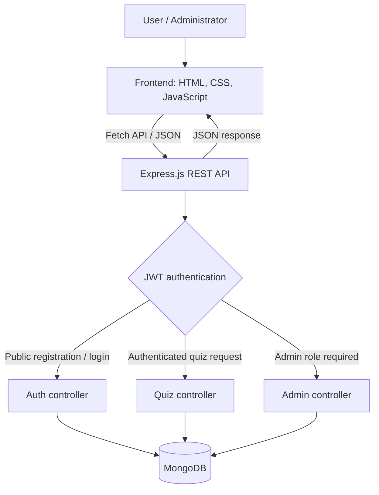

<div align="center">

# 🧠 Quizie — Online Quiz Application

**A full-stack quiz platform with secure login, randomized questions, timed assessments, instant scoring, and role-based administration.**

[](https://nodejs.org/)
[](https://expressjs.com/)
[](https://www.mongodb.com/)
[](https://developer.mozilla.org/en-US/docs/Web/JavaScript)

[Features](#-key-features) · [Architecture](#-system-architecture) · [Getting Started](#-getting-started) · [API Reference](#-rest-api-reference) · [Workflow](#-application-workflow)

</div>

---

## 📖 Overview

**Quizie** is a full-stack online quiz application for creating and attempting multiple-choice assessments. Registered users can take a randomized, time-limited quiz and view their results immediately. Administrators have a dedicated interface for managing the question bank and reviewing all quiz results.

The frontend is built with **HTML5, CSS3, and vanilla JavaScript**. A **Node.js + Express.js** backend provides RESTful JSON APIs, while **MongoDB with Mongoose** stores users, questions, and results. Authentication uses **JSON Web Tokens (JWT)**, and authorization is enforced on protected admin routes.

### 🎯 Project objectives

- Provide a straightforward platform for online multiple-choice assessments.
- Authenticate users and separate regular-user and administrator privileges.
- Randomize questions to make successive attempts less predictable.
- Automate timed quiz submission and score calculation.
- Persist user results for later review.
- Build a maintainable client–server application around REST APIs.

## ✨ Key features

### 👤 For users

- **Registration and login:** JWT-based authentication with passwords hashed using `bcryptjs`.
- **Random question selection:** MongoDB aggregation with `$sample`; an optional category filter is supported by the API.
- **Timed quizzes:** A **5-minute countdown** for a **10-question** quiz by default, with frontend auto-submission when time expires.
- **Question navigation:** Move forward and backward; selections are retained during the attempt.
- **Instant scoring:** The server compares submitted answers to stored answer keys and returns the score.
- **Result history:** View results associated with the signed-in account.

### 🛡️ For administrators

- Add, list, edit, and delete quiz questions.
- Review all recorded quiz submissions.
- Access administrator endpoints only after both JWT verification and an `admin` role check.
- Create an initial admin account using optional environment-variable configuration.

## 🧰 Technology stack

| Layer | Technologies | Role |
| --- | --- | --- |
| Frontend | HTML5, CSS3, vanilla JavaScript | Forms, quiz UI, timer, navigation, results |
| Client–server communication | Fetch API, JSON | Asynchronous HTTP requests |
| Backend | Node.js, Express.js | API routing and business logic |
| Database | MongoDB, Mongoose | Document storage and schemas |
| Authentication | JWT, `bcryptjs` | Signed access tokens and password hashing |
| Middleware | `cors`, `morgan`, `dotenv` | Cross-origin configuration, request logs, environment variables |
| Development | `nodemon` | Restart server on source changes |

## 🏗️ System architecture



**Architecture notes:**

1. **Frontend:** Displays the authentication form, quiz questions, timer, results, and administration screens.
2. **API layer:** Express mounts `/api/auth`, `/api/quiz`, and `/api/admin` route groups.
3. **Authentication middleware:** Verifies a Bearer JWT and loads the associated user; admin middleware additionally checks `role === 'admin'`.
4. **Controllers:** Handle registration/login, question selection, scoring, result retrieval, and administrative CRUD operations.
5. **Database models:** Define the structure of users, questions, and results using Mongoose.

## 📁 Project structure

```text
Quizie/
├── backend/
│   ├── controllers/
│   │   ├── authController.js
│   │   ├── quizController.js
│   │   └── adminController.js
│   ├── database/
│   │   └── db.js
│   ├── middleware/
│   │   └── authMiddleware.js
│   ├── models/
│   │   ├── userModel.js
│   │   ├── questionModel.js
│   │   └── resultModel.js
│   ├── routes/
│   │   ├── authRoutes.js
│   │   ├── quizRoutes.js
│   │   └── adminRoutes.js
│   ├── server.js
│   └── package.json
├── frontend/
│   ├── scripts/
│   │   ├── app.js
│   │   └── quiz.js
│   ├── styles/
│   └── index.html
└── README.md
```

## Login Window


## Admin-accessible Question Set


*The tree highlights key verified files; other frontend assets/pages may also be present.*

## 🔄 Application workflow

1. **Register or log in.** The frontend sends credentials to `/api/auth/register` or `/api/auth/login`. After validation, the server returns user information and a signed JWT.
2. **Authenticate subsequent requests.** The client sends the token as `Authorization: Bearer <token>`. Protected routes verify it before continuing.
3. **Load a quiz.** The client requests `/api/quiz/questions?limit=10`. MongoDB selects random questions using `$sample`; the public quiz response excludes correct answers.
4. **Attempt the quiz.** The frontend renders one question at a time, remembers selected options, and runs a five-minute countdown.
5. **Submit answers.** Clicking Submit or reaching zero on the countdown triggers `POST /api/quiz/submit` with question IDs and selected option indexes. Unanswered questions are sent with `selectedIndex: -1`.
6. **Calculate and save the result.** The backend retrieves the original questions, awards one point per correct answer, creates a result document, and returns `score`, `totalQuestions`, and `resultId`.
7. **Review results.** Users can fetch their history from `/api/quiz/results/me`. Administrators can fetch all results through `/api/admin/results`.

> **Implementation note:** The current timer is client-side. For high-stakes exams, also enforce deadlines and one-time attempt rules on the server; a browser-only countdown can be bypassed.

## 🚀 Getting started

### Prerequisites

- [Node.js](https://nodejs.org/) and npm
- [MongoDB Community Server](https://www.mongodb.com/try/download/community) running locally, **or** a MongoDB Atlas connection string
- Git

### 1. Clone the repository

```bash
git clone https://github.com/adityaap11/Quizie.git
cd Quizie/backend
```

### 2. Install dependencies

```bash
npm install
```

### 3. Create backend environment variables

Create `backend/.env` (next to `server.js`):

```dotenv
PORT=3000
MONGO_URI=mongodb://127.0.0.1:27017/quizie
JWT_SECRET=replace_with_a_long_random_secret
JWT_EXPIRES_IN=1d
CLIENT_ORIGIN=http://localhost:3000

# Optional: create a default admin on startup
DEFAULT_ADMIN_EMAIL=admin@example.com
DEFAULT_ADMIN_PASSWORD=replace_with_a_strong_password
```

**Important:** Use a strong, unique `JWT_SECRET`. Do not commit `.env` or real credentials to Git. To generate a secret with Node.js:

```bash
node -e "console.log(require('crypto').randomBytes(32).toString('hex'))"
```

If using Atlas, replace `MONGO_URI` with the Atlas connection string. If you do not want a seeded administrator, omit both `DEFAULT_ADMIN_*` values.

### 4. Start MongoDB

Ensure your local MongoDB service is running (or Atlas is reachable). For a locally installed MongoDB instance, the example URI above uses database `quizie`.

### 5. Run the application

```bash
npm start
```

For development with automatic restart:

```bash
npm run dev
```

The Express server serves the frontend as static files, so open:

**http://localhost:3000**

> **First-run tip:** Before taking a quiz, log in as an administrator and add some questions. The quiz page displays a message if the question bank is empty.

## 🔌 REST API reference

Base URL: `http://localhost:3000/api`

### Authentication

| Method | Endpoint | Access | Description |
| --- | --- | --- | --- |
| `POST` | `/auth/register` | Public | Register a new user |
| `POST` | `/auth/login` | Public | Log in and receive JWT |
| `GET` | `/auth/me` | Authenticated | Get current user |

### Quiz

| Method | Endpoint | Access | Description |
| --- | --- | --- | --- |
| `GET` | `/quiz/questions?limit=10` | Authenticated | Get randomized questions |
| `GET` | `/quiz/questions?limit=10&category=General` | Authenticated | Get randomized questions by category |
| `POST` | `/quiz/submit` | Authenticated | Submit answers and receive score |
| `GET` | `/quiz/results/me` | Authenticated | Get signed-in user's results |

### Administration

| Method | Endpoint | Access | Description |
| --- | --- | --- | --- |
| `GET` | `/admin/questions` | Admin | List all questions |
| `POST` | `/admin/questions` | Admin | Create a question |
| `PUT` | `/admin/questions/:id` | Admin | Update a question |
| `DELETE` | `/admin/questions/:id` | Admin | Delete a question |
| `GET` | `/admin/results` | Admin | View all results |

Protected endpoints require the header:

```http
Authorization: Bearer <your_jwt_token>
```

### Example: register

```http
POST /api/auth/register
Content-Type: application/json

{
  "name": "Sample User",
  "email": "user@example.com",
  "password": "choose_a_secure_password"
}
```

### Example: add a question (admin only)

```http
POST /api/admin/questions
Authorization: Bearer <admin_jwt_token>
Content-Type: application/json

{
  "questionText": "Which language runs natively in a web browser?",
  "options": ["Python", "JavaScript", "C++", "Java"],
  "correctAnswerIndex": 1,
  "category": "Web Development"
}
```

`correctAnswerIndex` is **zero-based** (here, `1` means the second option). Questions require at least two options.

### Example: submit a quiz

```http
POST /api/quiz/submit
Authorization: Bearer <user_jwt_token>
Content-Type: application/json

{
  "answers": [
    { "questionId": "<question_object_id_1>", "selectedIndex": 1 },
    { "questionId": "<question_object_id_2>", "selectedIndex": -1 }
  ]
}
```

Example response (illustrative IDs and scores):

```json
{
  "score": 1,
  "totalQuestions": 2,
  "resultId": "<result_object_id>"
}
```

## 🗄️ Data models

| Model | Important fields | Purpose |
| --- | --- | --- |
| **User** | `name`, `email`, `password`, `role` | Accounts and privileges; passwords are hashed |
| **Question** | `questionText`, `options`, `correctAnswerIndex`, `category` | Question bank and correct answer |
| **Result** | `user`, `score`, `totalQuestions`, `details` | Stores each quiz attempt and per-question answer details |

Results reference users and questions using MongoDB ObjectIds. Mongoose timestamps track document creation and updates.

## 🔐 Security and authorization

- Passwords are hashed with `bcryptjs` before they are saved.
- JWTs are signed using the server-side `JWT_SECRET` and have configurable expiration.
- Middleware verifies JWTs and retrieves the authenticated user from MongoDB.
- All `/api/admin` routes require both authentication and an administrator role.
- Correct answers are omitted from the randomized question-fetch response.
- Submitted answers are scored using the database's correct-answer indexes, not a score supplied by the browser.

**Production considerations:** The repository is appropriate as a learning project, but deployment for real assessments should add server-enforced deadlines, attempt/session integrity, request rate limiting, stronger input validation, secure token-storage practices, and additional automated tests. The current quiz endpoint does not itself enforce server-side time limits or single-attempt rules.

## 🧪 Suggested manual testing checklist

- [ ] Register a new user and verify login succeeds.
- [ ] Try invalid login credentials; confirm rejection.
- [ ] Verify protected requests fail without a JWT.
- [ ] Verify a regular user cannot call admin endpoints.
- [ ] Add questions as an administrator and fetch a randomized quiz.
- [ ] Navigate between questions and confirm answer selections persist.
- [ ] Submit manually and verify the resulting score.
- [ ] Allow the five-minute timer to expire and confirm auto-submission.
- [ ] Check that users see only their own result history.
- [ ] Confirm administrators can view all results and update/delete questions.

## 🔭 Future improvements

- Enforce quiz deadlines and attempt limits on the server.
- Add quiz categories, difficulty levels, and configurable durations in the UI.
- Support question pools and more detailed performance analytics.
- Add automated API tests and CI checks.
- Improve accessibility, responsive layout, and feedback after each assessment.
- Add deployment documentation and environment-specific configuration.

## 👨‍💻 Repository

**GitHub:** [adityaap11/Quizie](https://github.com/adityaap11/Quizie)

Developed as a full-stack project demonstrating REST API development, database integration, authentication, authorization, and interactive frontend behavior.

---

<div align="center">
  <sub>Built with Node.js, Express.js, MongoDB, and JavaScript.</sub>
</div>
